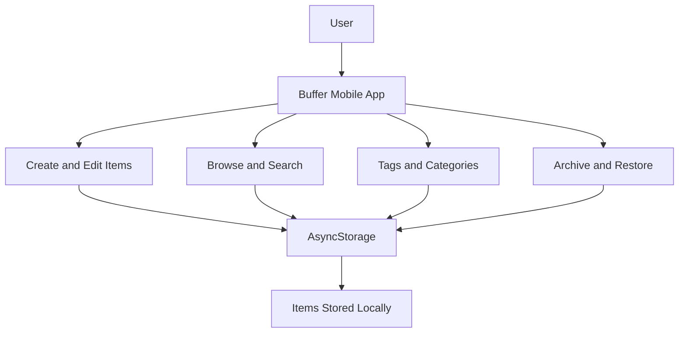

# Buffer — Your Little Corner of the Internet

Buffer is a personal save-for-later mobile app for storing useful notes, links, code snippets, and images in one place.

## Features

- Save notes, links, snippets, and images.
- Browse all saved items or filter by category.
- Search items by title, content, and tags.
- Add tags to organize saved content.
- Edit saved items.
- Archive items and restore them later.
- Delete items with confirmation.
- Preview saved images.
- Store data locally on the device.
- Dark interface with blue accents.

## Technology Stack

- React Native
- Expo
- TypeScript
- AsyncStorage
- Expo Go
- EAS Build

## Architecture

Buffer uses a local-first architecture. The mobile app manages saved items and stores them on the device using AsyncStorage. Stage 1 does not require authentication or a remote backend.



## Data Model

Each saved item contains:

| Field | Description |
|---|---|
| `id` | Unique item identifier |
| `type` | `note`, `link`, `snippet`, or `image` |
| `title` | Item title |
| `content` | Saved text, URL, snippet, or image URI |
| `tags` | List of tags |
| `createdAt` | Creation timestamp |
| `updatedAt` | Last updated timestamp |
| `archived` | Whether the item is archived |

## Local Storage

Buffer uses `@react-native-async-storage/async-storage` to save items locally on the device.

Storage key: `pocketinbox.items.v1`

No account or remote backend is required for Stage 1. Data is stored locally and is not automatically synchronized across devices.

## Getting Started

### Prerequisites

- Node.js
- npm
- Expo Go on a compatible mobile device, or an appropriate development environment

### Install Dependencies

Open a terminal in the project directory and run:

```bash
npm install
```

### Start the App

```bash
npx expo start
```

On Windows PowerShell, if `npx` is blocked by the execution policy, use:

```powershell
npx.cmd expo start
```

Open the project in Expo Go or another supported development environment.

## Android APK Build

The project can be built for Android using Expo Application Services (EAS Build).

Run:

```powershell
npx.cmd eas-cli@latest build --platform android --profile preview
```

Follow any prompts to sign in or configure EAS.

After the build completes, use the APK link provided by EAS to download and install the application.

**APK download link:** Replace this line with the actual EAS APK link after the build succeeds.

## Project Status

**Stage 1 — Local save-for-later app**

The app focuses on saving, finding, editing, organizing, archiving, restoring, and deleting content on a single device.

## Current Limitations

- No authentication.
- No cloud synchronization.
- Saved data is device-specific.
- Image availability can depend on the image URL or URI and device permissions.

## Possible Future Improvements

- Optional private cloud synchronization.
- Share-sheet integration for saving content from other apps.
- Import and export functionality.
- Additional organization and filtering options.

## License

Created for a mobile app development challenge. No separate open-source license has been specified.
